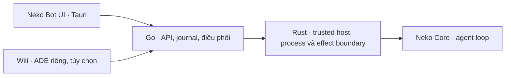

# Neko Bot

Trợ lý đa bot, đa kênh theo hướng **local-first**. Neko Bot hướng tới việc phối hợp nhiều bot có danh tính và chỉ dẫn riêng, giữ lịch sử công việc bền vững, nhận tin mới khi tác vụ cũ đang chạy và trả kết quả vào đúng kênh được phép.

**Trạng thái: bản phát triển, chưa phải sản phẩm production hoàn chỉnh.** Repository này tập hợp mã nguồn ứng dụng, Neko Core liên quan và một overlay tích hợp Wiii. Không kèm installer, tài khoản, credentials, dữ liệu chat hay runtime đã cấu hình sẵn.

## Kiến trúc



Neko Core sở hữu vòng lặp agent. Go quản lý trạng thái và hợp đồng thực thi; Rust giữ các ranh giới tin cậy trên máy. Wiii là giao diện ADE riêng, không thay thế Neko Bot UI.

| Thư mục | Vai trò |
|---|---|
| `app/native/` | Go control plane, HTTP/SSE local, journal, bot/kênh/project/task/file |
| `app/host/` | Rust trusted host, secure input, process và receipt |
| `app/desktop/` | Tauri desktop shell |
| `core/` | Neko Core, TypeScript/Bun; runtime và adapter liên quan |
| `wiii/` | 61 file overlay tích hợp Wiii; **không phải full Wiii repository** |
| `migration/` | Provenance, manifest source và workflow được lưu ở trạng thái không tự chạy |

## Hiện có và giới hạn kiểm chứng

Các chức năng dưới đây có source và bằng chứng kiểm thử local đã ghi trong tài liệu của từng lát cắt. Chúng không phải cam kết tương thích mọi provider, hệ điều hành hay thiết bị.

| Phạm vi | Hiện có | Giới hạn |
|---|---|---|
| Bot và hội thoại | Nhiều bot, ID/alias ổn định, chỉ dẫn riêng; hội thoại riêng và kênh chung local | Việc chia sẻ ngữ cảnh phụ thuộc scope/ACL; không có quyền đọc mọi kênh mặc định |
| Công việc bền vững | Journal, idempotency/receipt, phục hồi, hủy và các control có hợp đồng riêng | Một số trạng thái cần thao tác phục hồi tường minh; không tuyên bố exactly-once cho mọi effect bên ngoài |
| Tương tác đang chạy | Foreground/background, bổ sung/thay thế yêu cầu và nhóm cộng tác hữu hạn | Bằng chứng native/Core dùng provider loopback có kiểm soát, chưa là đánh giá model thật |
| Project và file | Nguồn UTF-8/DOCX có giới hạn, chọn nguồn liên quan, preview/download kết quả theo scope | Không phải dịch vụ lưu trữ hoặc chia sẻ file cloud hoàn chỉnh |
| Tài khoản và runtime | Secure input qua Rust/Windows DPAPI, metadata và pin runtime/profile | Tài khoản lưu vẫn có thể là `stored_unverified`; broker/OAuth và vòng đời provider thật chưa nghiệm thu |
| Giao diện | UI thích ứng, kiểm thử trình duyệt về interaction/focus và viewport | Chưa phải ứng dụng iOS/Android được phát hành; chưa nghiệm thu điện thoại thật hoặc AT speech |

HTTP/SSE local và mô phỏng hai client **không phải cloud sync**. Cloud/device pairing, đồng bộ nhiều máy, đánh giá provider/model thật, đóng gói/phát hành và các gate thiết bị vẫn là phần tiếp tục phát triển. Saved-account witness là WIP, không phải đường thực thi mặc định đã hoàn tất.

Xem [ma trận khoảng trống sản phẩm](app/docs/product-gap-matrix-20261011.md), [hợp đồng desktop instance](app/docs/desktop-local-instance-20261012.md) và các tài liệu delivery/review trong `app/docs/`. Các log/capture và binary của những lần kiểm thử lịch sử không được đưa vào repository này. Kết quả lịch sử chỉ áp dụng cho commit và môi trường đã ghi, không thay cho một lần kiểm thử checkout hiện tại.

## Build và chạy local trên Windows

Hướng dẫn sau dùng PowerShell, từ root repository. Cần Git, Go **1.27+** theo `app/native/go.mod`, Rust/Cargo với toolchain MSVC và Windows SDK. Tauri cần Microsoft Edge WebView2 Runtime. Dependency Rust có thể cần tải ở lần build đầu; Go module hiện không có dependency bên thứ ba.

```powershell
git clone https://github.com/meiiie/nekobot-transfer-20261016.git
Set-Location nekobot-transfer-20261016
New-Item -ItemType Directory -Force app/.build | Out-Null

Push-Location app/native
try {
    go build -o ../.build/neko-control.exe ./cmd/neko-control
    if ($LASTEXITCODE -ne 0) { throw 'Go build failed' }
} finally { Pop-Location }

cargo build --locked --manifest-path app/host/Cargo.toml --target-dir app/.build/host-target
if ($LASTEXITCODE -ne 0) { throw 'Host build failed' }
Copy-Item app/.build/host-target/debug/neko-host.exe app/.build/neko-host.exe
```

Chạy Go và mở `http://127.0.0.1:8765` trong trình duyệt:

```powershell
./app/.build/neko-control.exe --state ./app/.state/local --listen 127.0.0.1:8765
```

Port phải còn trống; Ctrl+C dừng service. Dữ liệu được ghi dưới state đã chọn. Khi không có cấu hình Core được chấp thuận, tin nhắn được lưu và chờ runtime (`waiting_host`), không tự gọi provider. Lưu tài khoản không đồng nghĩa với cấp quyền hoặc xác minh tài khoản đó. Không đưa state, receipt chứa challenge hay credentials vào Git.

### Tauri desktop

Build shell:

```powershell
cargo build --locked --manifest-path app/desktop/Cargo.toml --target-dir app/.build/desktop-target
if ($LASTEXITCODE -ne 0) { throw 'Desktop build failed' }
Copy-Item app/.build/desktop-target/debug/neko-desktop.exe app/.build/neko-desktop.exe
```

Shell hiện tại yêu cầu startup receipt và xác minh process/port/hash/state, nên không mở chỉ bằng double-click hoặc launcher `run-local.ps1 -Desktop` cũ. Tạo manifest hash **development** cho chính các binary vừa build, rồi dùng launcher hiện tại:

```powershell
function Get-LocalBinaryEntry([string]$Name) {
    $path = Join-Path 'app/.build' $Name
    @{ path = ".build/$Name"; sha256 = (Get-FileHash -Algorithm SHA256 -LiteralPath $path).Hash.ToLowerInvariant() }
}
$localManifest = @{
    version = 1
    scope = 'local-journal'
    appCommit = (git rev-parse HEAD).Trim()
    desktopLaunchContract = 1
    control = Get-LocalBinaryEntry 'neko-control.exe'
    host = Get-LocalBinaryEntry 'neko-host.exe'
    desktop = Get-LocalBinaryEntry 'neko-desktop.exe'
}
$localManifest | ConvertTo-Json -Depth 4 | Set-Content -Encoding utf8 app/.build/dev-launch.json
./app/scripts/run-prebuilt-local.ps1 -Manifest app/.build/dev-launch.json -Desktop -CheckOnly
./app/scripts/run-prebuilt-local.ps1 -Manifest app/.build/dev-launch.json -Desktop
```

Manifest này chỉ ràng buộc hash của build local do bạn chọn; nó không phải chữ ký, installer hay chứng nhận release. Launcher tạo startup receipt mới, kiểm tra Go child trước khi mở WebView và chỉ dừng process do nó sở hữu. Chạy trình duyệt và desktop lần lượt, hoặc dùng `-Port` khác để tránh xung đột. Core/helper được pin bằng các hợp đồng riêng; build shell không tự kích hoạt agent runtime.

### Kiểm tra code

```powershell
Push-Location app/native
try {
    go test -count=1 ./...
    go vet ./...
} finally { Pop-Location }
cargo test --locked --manifest-path app/host/Cargo.toml
```

Các runner native/Core/browser cần thêm binary, fixture và pin đúng hợp đồng. Không chạy một runner có đường dẫn/pin lịch sử rồi coi đó là kiểm thử bản hiện tại. Chỉ dùng `--offline` cho Cargo khi dependency đã có trong cache.

### Phát triển Neko Core

Core là project độc lập trong `core/`. CI được lưu kèm source pin Bun **1.4.0**; dùng lockfile thay vì tự nâng dependency:

```powershell
Push-Location core
try {
    bun install --frozen-lockfile
    bun run typecheck
    bun test
    # Build binary và các smoke gate do package.json định nghĩa:
    # bun run build
} finally { Pop-Location }
```

Đọc [Core working rules](core/AGENTS.md) và [quy trình kiểm thử](core/docs/process/TESTING.md) trước khi thay runtime. Không dùng tài khoản/provider thật để thay thế fixture kiểm thử.

## Wiii integration

`wiii/` chứa đúng 61 file overlay từ checkpoint `d2e8284b34d2431e21e4ca8df41c82b3270d4a50`, gồm bridge và bounded-history repair. Nó thiếu phần còn lại của Wiii, nên không có lệnh install/build standalone hợp lệ ngay trong thư mục này.

Base là bản Wiii được khôi phục byte-bound từ hai archive source, có metadata gốc ghi commit `6b1c30b15b4c67e3c841ae870e6989577fc228f8`. Đây không phải lời đảm bảo rằng một checkout mới của commit đó hoặc nhánh Wiii hiện hành khớp toàn bộ archive working tree. Hash hai archive và phạm vi được ghi trong [Wiii integration manifest](migration/wiii-integration.json); archive không được phân phối ở đây. Cần kiểm tra base trong thư mục riêng trước khi ghép overlay. **Không ghi đè một checkout Wiii đang dùng.**

## Các nhánh

| Nhánh | Mục đích |
|---|---|
| `main` | Snapshot phát triển tích hợp: app `90bdcef`, Core `93d6c01` và Wiii overlay `d2e8284`; không phải stable release |
| `wip/saved-account-witness` | Giữ 5 file witness chưa hoàn tất. Windows Issue test hợp lệ đầu tiên từng FAIL; Core bootstrap/CLI wiring còn thiếu |
| `wip/main-local-scripts` | Giữ 3 script đang sửa trên baseline app `7f80d55`; chưa nghiệm thu lại |
| `archive/ui-integration-f6` | Snapshot UI cũ phục vụ đối chiếu; không chọn làm runtime hiện hành |

Các nhánh WIP/archive có thể khác `main` cả code lẫn tài liệu. Provenance từng file nằm trong `migration/source-manifest.json`; không nhầm commit của snapshot gom source với commit gốc hoặc một GitHub Release. Workflow upstream được giữ dưới `migration/disabled-workflows/`, không tự triển khai khi push repo này.

## Attribution và giấy phép

Repository này không tạo một giấy phép chung mới cho mọi component.

- Neko Core giữ [LICENSE](core/LICENSE), [NOTICE](core/NOTICE) và [license map](core/LICENSING.md): original core material là AGPL-3.0-only, còn ranh giới `sdk/` và material bên ngoài theo notice tương ứng. Không suy rộng Apache-2.0 từ SDK sang toàn Core/app.
- Wiii overlay giữ [LICENSE](wiii/LICENSE), [license map](wiii/LICENSING.md) và [trademark notice](wiii/TRADEMARKS.md).
- Neko Peek artwork giữ AGPL-3.0 provenance; Geist giữ SIL OFL1.1. [Asset provenance và license](app/native/internal/web/assets/brand/neko-peek/PROVENANCE.md) đi kèm source và notice gốc.
- `app/` chưa có LICENSE tổng thể. Việc công khai repository không tự cấp một giấy phép mới cho các file chưa có grant tương ứng. Giữ nguyên attribution và kiểm tra phạm vi từng file trước khi tái sử dụng/phân phối.

Grok bundle chỉ được dùng làm reference UX đọc; bundle, source/assets không được phép phân phối và archive tham chiếu không nằm trong repo này.
