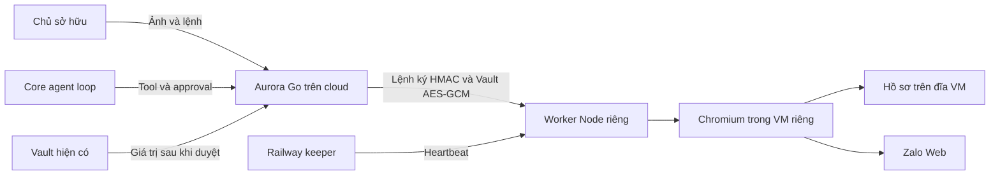

# Máy tính cloud của Aurora

Ngày đối chiếu: 2026-10-25. Base commit `ffab4500e3a7abab9e22d3d5375527190ff8f08b`, nhánh làm việc `feat/cloud-browser-workstation`. Thay đổi hiện nằm trong working tree cùng phần giao tiếp agent trước đó.

## Ranh giới thực thi

Go xác thực chủ sở hữu, chọn bot, kiểm tra Work hiện tại và xử lý Vault. Worker giữ trình duyệt, quyền điều khiển, observation và biên nhận thao tác. Core tiếp tục sở hữu agent loop. Các đường cloud không chạy Chrome trên máy người dùng.

Worker không có API shell, CDP công khai, tải cookie hoặc đọc file hồ sơ. Mặc định chỉ một trình duyệt hoạt động. Worker đóng trình duyệt sau 10 phút không hoạt động nhưng giữ hồ sơ trên đĩa của máy chạy worker. Docker dùng named volume; bản Railway hiện dùng đĩa của VM, với giới hạn khôi phục mô tả bên dưới.

## Phần học từ Wiii

Nguồn tham khảo là [meiiie/wiii tại commit 6b1c30b](https://github.com/meiiie/wiii/tree/6b1c30b15b4c67e3c841ae870e6989577fc228f8). Bản clone đầy đủ nằm tại `reference/wiii`; overlay `wiii/` hiện có được giữ nguyên.

Thiết kế áp dụng hai ý chính: giữ hồ sơ Chrome ngoài vòng đời tiến trình và thu hồi lệnh agent trước khi giao màn hình cho người. Aurora dùng worker cloud có kiểm tra quyền ở server. Tính năng `view_only` phía noVNC của Wiii không được dùng làm ranh giới quyền cho Aurora.

Mã và tài sản của Wiii không được chép vào tính năng này. License của app Wiii và SDK có phạm vi khác nhau.

## Quyền và biên nhận

Mỗi state directory của Aurora có namespace bền vững. Mỗi bot có hồ sơ riêng trong namespace. HTTP từ trình duyệt không được tự chọn namespace, actor, URL worker hoặc bot khác trong payload.

Quyền điều khiển gồm `paused`, `owner` và `agent`. Đổi quyền tăng epoch, làm mất hiệu lực observation cũ và chặn lệnh agent đã xếp hàng. Lệnh đang chạy phải kết thúc hoặc đóng context trước khi xác nhận giao quyền. Hết hạn quyền owner thì worker tạm dừng, không tự giao lại cho agent.

Mỗi thao tác có nonce và dấu vân tay payload được ghi vào SQLite trước khi chạy. Các trạng thái biên nhận có nghĩa sau:

| Trạng thái | Ý nghĩa |
| --- | --- |
| `dispatched` | Worker đã chuyển thao tác tới trình duyệt. Trang có thể chưa hoàn thành tác vụ. |
| `rejected` | Worker từ chối trước tác động đã biết. |
| `unknown` | Có thể đã có tác động. Worker không tự gửi lại. |

Nhận biên nhận không chứng minh tin nhắn đã gửi hoặc đăng nhập thành công. Thao tác agent cần approval bất biến được Go ký, gắn đúng bot, Work, epoch và attempt. Work có nguồn từ agent khác không được dùng các tool cloud này.

Nếu Go khởi động lại sau khi approval cloud đã được duyệt nhưng chưa lưu biên nhận, startup ghi kết quả `unknown` bền vững và không gửi lại lệnh. Cơ chế này chạy cả khi agent loop hoặc kết nối worker chưa được bật. Approval chưa duyệt và biên nhận đã lưu được giữ nguyên; owner cần quan sát mới trước khi tạo thao tác khác.

## Vault và đăng nhập

UI tải metadata mục đăng nhập. Go chỉ giải mã giá trị sau khi kiểm tra xác nhận, origin chính xác, phiên bản mục Vault và observation. Worker nhận giá trị qua AES-256-GCM, không nhận khóa chính Vault và không tự submit form.

Trang đăng nhập, QR và challenge yêu cầu owner điều khiển. Model không nhận ảnh hoặc nội dung nhạy cảm của bước này. Giá trị owner nhập trực tiếp không đi vào chat hoặc localStorage của giao diện.

Adapter Chromium hiện chưa trả bằng chứng danh tính Zalo đã xác minh. Nhãn đăng nhập vì vậy có thể là `unknown` sau khi owner đăng nhập. Quyền dùng hồ sơ tách khỏi xác minh danh tính: owner có thể bấm **Cho phép agent dùng hồ sơ này** sau một quan sát mới không còn bước đăng nhập hoặc bảo vệ. Worker yêu cầu trang đang hoạt động và có nội dung sử dụng được, rồi tăng epoch khi giao quyền. Go chỉ trả nội dung và target khi worker báo rõ `protected: false`, trang sẵn sàng và agent đang giữ điều khiển. Thiếu trường `protected`, trang trống, QR hoặc challenge đều chặn đường này. Ảnh luôn chỉ dành cho owner. Không suy ra đăng nhập từ cookie, HTTP 200 hoặc việc mã QR biến mất.

Hồ sơ dùng thư mục riêng và quyền file của Linux. Tính năng không bổ sung một lớp mã hóa toàn bộ hồ sơ Chrome. Cookie trong hồ sơ cần được bảo vệ như phiên đăng nhập tài khoản.

Hosted mode chỉ bật tính năng cho email khớp chính xác với biến server `AURORA_CLOUD_BROWSER_EMAILS`. Thiếu cấu hình này thì tính năng bị tắt cho tenant hosted. Chế độ standalone giữ cơ chế owner hiện có.

Khi chủ sở hữu xác nhận xóa tài khoản Aurora đã dùng trình duyệt, Go yêu cầu worker xóa namespace trước khi xóa dữ liệu tenant. Worker ghi tombstone bền vững, chặn lệnh mới, đóng và chờ các actor, rồi kiểm tra `/proc` để chắc chắn không còn tiến trình Chromium ghi hồ sơ đó. Nếu chưa chứng minh được điều này, xóa trả trạng thái chờ và giữ locator của tenant để thử lại. Endpoint purge chỉ nhận yêu cầu nội bộ có chữ ký; không có tool agent hoặc đường UI cho phép chọn namespace tùy ý. Không xóa tài khoản thật trong kiểm thử.

## Cấu hình

| Nơi đặt | Biến | Giá trị |
| --- | --- | --- |
| Aurora Go | `AURORA_CLOUD_BROWSER_URL` | HTTPS hoặc HTTP qua hostname `*.railway.internal` hay `*.aurora.internal`; không nhận địa chỉ localhost hoặc IP trực tiếp. |
| Aurora Go, chỉ khi chạy Docker tạm | `AURORA_CLOUD_BROWSER_DOCKER` | `1` bật transport riêng tới HTTP literal `127.0.0.1` với cổng rõ ràng từ 1024 đến 65535. Server tự đặt cấu hình; HTTP từ UI không được bật chế độ này. |
| Aurora Go và worker | `AURORA_CLOUD_BROWSER_KEY` | Cùng khóa dịch vụ ngẫu nhiên, ít nhất 32 byte. |
| Aurora Go, hosted mode | `AURORA_CLOUD_BROWSER_EMAILS` | Danh sách email pilot được phép dùng máy cloud. |
| Worker | `DATA_DIR` | `/data` trong image. |
| Worker | `PORT` | `8080` theo cấu hình image. |

Worker dùng Node 24 trở lên và Playwright `1.64.1` được khóa trong `package-lock.json`. Chromium chạy bằng user riêng, bật sandbox và chỉ nhận môi trường tối thiểu. Proxy CONNECT kiểm tra hostname, DNS và địa chỉ đích để chặn mạng nội bộ, metadata và đường UDP trực tiếp.

Listener của worker hỗ trợ IPv4 và IPv6. Kiểm thử entrypoint thật đã tái hiện lỗi IPv6 trước sửa đổi và chạy thành công trên Windows lẫn Linux container sau sửa đổi; lệnh thiếu chữ ký vẫn bị từ chối ở cả hai địa chỉ. Bộ Node hiện có 75 kiểm thử, gồm purge, kiểm tra tiến trình còn sống và keeper. `.railwayignore` tại root và worker loại state, build, khóa, biến môi trường và thư mục tham khảo khỏi gói tải lên bằng CLI.

Danh sách đích mặc định gồm HTTPS hoặc WSS thuộc `zalo.me`, `zaloapp.com`, `zdn.vn` và subdomain. Lần chạy Zalo thật ngày 2026-10-25 xác định thêm đúng các host `stc-sp.zadn.vn`, `zalo-chat-static.zadn.vn`, `res-zalo.zadn.vn`, `s160-26-ava-talk.zadn.vn` và `ava-grp-talk.zadn.vn`. Các host này được cho phép riêng lẻ; domain cha `zadn.vn`, host giả mạo và DNS trỏ vào mạng riêng vẫn bị chặn.

[Hướng dẫn triển khai và dùng Vault](../cloud-browser/README.md) mô tả thao tác vận hành. [Hợp đồng triển khai](../../docs/superpowers/plans/2026-10-25-cloud-browser.md) ghi wire protocol và phân chia trách nhiệm.

## Phạm vi kiểm chứng

Các bộ kiểm thử Go kiểm tra owner, bot scope, Work, peer denial, approval, origin, phiên bản Vault và giao thức ký/mã hóa giữa Go với Node. Các bộ kiểm thử Node mặc định dùng driver giả để kiểm tra lease, nonce, khôi phục, egress và giới hạn thời gian. Kiểm thử UI dùng dữ liệu fixture và có kiểm tra cửa sổ được Go phục vụ thật khi worker chưa cấu hình.

Kết quả Docker được ghi riêng tại `app/.build/cloud/docker-validation.json`. Bài kiểm chứng Chromium tại `app/cloud-browser/tests/cloud-browser-live.mjs` có chế độ `prepare` và `check` để kiểm tra qua hai container trên cùng named volume. Kiểm chứng bổ sung `app/scripts/verify_cloud_owner.mjs` đi qua Go owner API, Vault thật với thông tin giả và Chromium HTTPS fixture; việc thay container vẫn giữ cookie, localStorage, IndexedDB và biên nhận, không lặp tác động. Mô hình thật đã gọi thành công `cloud_browser_observe` trên fixture riêng. Các kết quả này không chứng minh đăng nhập Zalo thật.

Image controller `neko-aurora-controller:cloud-candidate` đã build từ Dockerfile gốc, gồm Go server, UI và Core. Container Linux riêng với state tmpfs và owner giả đã qua năm kiểm tra: từ chối API khi chưa đăng nhập, cấp cookie có Secure/HttpOnly/SameSite, owner truy cập cloud API, phục vụ tài sản giao diện cloud và chặn Origin khác. Báo cáo `app/.build/cloud/controller-image-acceptance.json` ghi phạm vi cục bộ; kiểm chứng Railway được ghi riêng bên dưới.

Thử nghiệm Docker trước đó phục vụ UI tại cổng 8765 với state `network-live`. Owner đã báo đăng nhập Zalo; hồ sơ vẫn tải được trang tài khoản sau khi thay container. Zalo sau đó báo **Đổi thiết bị** và ngắt phiên vì tài khoản đăng nhập ở trình duyệt khác. Đây là kết quả lịch sử của máy thử cục bộ, không phải phiên của VM cloud mới.

## Railway đã triển khai, 2026-10-25

Railway CLI đã xác thực thành công. Aurora hosted đang chạy tại [cổng cloud](https://neko-aurora-production.up.railway.app/app/), deployment `29d46dfe-5c41-4c07-afe9-470b7e9dac8e` có trạng thái `SUCCESS`. Chế độ hosted, volume dữ liệu, Vault secret và model key có sẵn được giữ nguyên. Bản tải lên là source đã lọc và kiểm tra, không phải toàn bộ working tree; chưa tạo commit hoặc push Git.

Chromium trong service Railway thông thường bị kernel từ chối ở `credentials.cc:131` khi bật sandbox. Không bỏ sandbox để vượt lỗi. Máy trình duyệt thực tế là Railway Sandbox VM riêng, 1 CPU / 1 GiB, worker chạy UID `10001`, Chromium vẫn bật sandbox. Go gọi trực tiếp hostname riêng của VM qua giao thức ký và mã hóa hiện có. VM không nhận Railway API token, khóa chính Vault hoặc model key.

Service `aurora-browser-worker` hiện chỉ chạy keeper, deployment `df37fb48-b494-4c19-b0a9-a365cca87cde` có trạng thái `SUCCESS`. Keeper gửi heartbeat mỗi 60 giây cho một VM đã định sẵn, timeout 10 giây, không có API browser, shell, tạo máy hoặc khôi phục máy. Token Railway ở service keeper qua variable reference. Heartbeat tạm trên máy phát triển đã dừng; phiên cloud không cần Docker Desktop hoặc trình duyệt cá nhân của người dùng chạy Zalo.

Trên VM thật, `node --test tests/cloud-browser-live.mjs` qua sáu kiểm tra bằng dữ liệu giả: Chromium, ảnh, Vault form, cookie/localStorage/IndexedDB qua restart worker, nonce không lặp tác động và tách namespace. Kiểm chứng `/proc` riêng tái hiện tiến trình còn sống, trả chờ xóa trước khi đụng hồ sơ, rồi xóa thành công khi tiến trình kết thúc; namespace khác vẫn còn. Các báo cáo nằm trong `app/.build/cloud/railway-vm-live-fixture.log` và `railway-vm-purge-proc-proof.json`.

Giao diện owner thật đã mở Zalo trên VM qua Go. QR được hiển thị riêng cho owner; đăng nhập Zalo thật trên VM đang chờ chủ tài khoản quét và xác nhận. Chưa cấp quyền dùng hồ sơ Zalo thật cho agent và chưa gửi tin nhắn. Không lưu QR, mật khẩu hoặc nội dung chat vào báo cáo.

Hồ sơ giữ được qua đóng/mở Chromium và restart worker khi VM còn tồn tại. **Đĩa VM hiện không phải volume bền vững qua hủy máy.** Keeper giữ VM hoạt động nhưng không bảo đảm phục hồi nếu máy bị hủy hoặc nền tảng thu hồi. Pilot chỉ có checkpoint base không chứa khóa hoặc hồ sơ; không chụp checkpoint tài khoản thật, không tự tạo lại hoặc khôi phục phiên. Sau khi mất VM, cần tạo máy sạch và owner đăng nhập lại. Backup volume gốc của controller chưa tạo được vì Railway yêu cầu gói Pro; không nâng gói hoặc thay volume gốc.

Full Go suite trên Windows vẫn có failure ở fixture shell Unix, quyền file Unix, cleanup file đang mở và một fixture documentworker có giới hạn thời gian. Các kiểm thử cloud và giao tiếp agent cần được đọc riêng trong báo cáo xác minh. Nhật ký cục bộ ở `app/.build/cloud` không được đưa vào commit vì có thể chứa dữ liệu vận hành.
