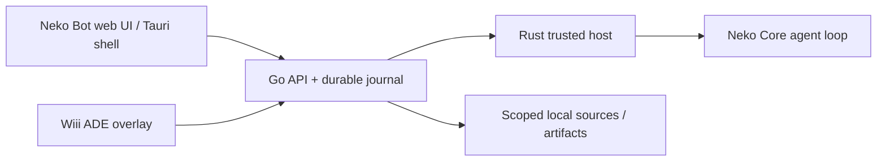

# Kiến trúc

[← Tài liệu](README.md) · [Trạng thái](project-status.md)

## Ai chịu trách nhiệm gì

- **Go** nhận request, ràng buộc bot/kênh/project/account/resource theo revision và nonce, lưu nghĩa vụ/trạng thái vào journal, phát snapshot/SSE và trả kết quả theo scope. Lịch sử bền vững không tự chứng minh effect bên ngoài đã hoàn tất.
- **Rust host** là trusted boundary cho secure input, process/runtime admission và receipts. Tauri shell chỉ mở service local sau xác minh instance; nhận đúng receipt không tự tạo authority cho một tác vụ mới.
- **Neko Core** sở hữu semantic agent loop. Adapter/profile đã pin nối Core vào hợp đồng Go/host; không thay agent loop bằng logic UI.
- **UI** hiển thị và lưu intent/retry theo contract, giữ nonce/counters khi trạng thái ACK chưa chắc chắn. Không tự nhập private history vào audience khác hoặc suy ra quyền từ metadata hiển thị.
- **Wiii** là ADE riêng. Repo này chứa 61 file overlay bridge/history repair, không gồm full Wiii base.

## Một request local

UI gửi intent đã có scope và nonce. Go kiểm điều kiện hiện tại rồi commit nghĩa vụ. Nếu chưa có runtime được cấu hình/chấp thuận, request chờ. Khi runtime hợp lệ, host/Core đi qua admission và effect boundary. Journal/snapshot/SSE giúp UI theo dõi kết quả; hủy/revoke/recovery phải giữ fence và provenance ban đầu.

Ảnh fixture hoặc một HTTP ACK không chứng minh đầy đủ quá trình trên. Các tests native/process có scope và binary pins riêng; xem [phạm vi bằng chứng](project-status.md).

## Phần chưa hoàn tất

Cloud/multi-device pairing, account broker/provider thật, physical-phone acceptance và đóng gói stable còn gate riêng. Không dùng sơ đồ này như tuyên bố các phần đó đã được triển khai/triển khai cloud. [Roadmap](ROADMAP.md) theo dõi các dependency này.
