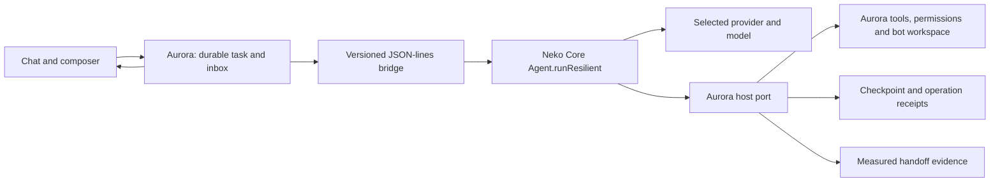

# Core ↔ Aurora harness

Development integration, 2026-11-02. This supersedes the Core quick-connection
portion of the [2026-10-23 runtime decision](runtime-decision-2026-10-23.md).
It is not a release, model-quality evaluation, or claim that every legacy route
has migrated.

## Ownership

Core chooses model/tool steps, retries and context management. Aurora retains
the owner inbox, bot identity, workspace, permissions, tool execution, approval
cards, schedules, journal, preview and download. The embedded composition exposes
only `mcp__aurora__execute`. Core local shell/filesystem, global MCP configuration
and subagents are unavailable. This composition does not weaken or impersonate
the separate attested ACP host profile or a native tool backend.

Selected `core-*` quick connections use `core/bin/aurora-agent.ts`, including
ChatGPT sign-in and GLM/API profiles. `runTurn` enters this route before the old
Go planner/tool/reviewer loop. Utility completions can still use
`aurora-completion.ts`; legacy direct HTTP routes retain their existing behavior.
No failed Core run silently falls back to another provider. Provider selection
is pinned within the turn. Saved state is bound to task, bot, epoch, model,
profile and folder; changing the folder during a run stops admission.
The runtime also supplies the bot's display name and exact selected model ID;
the provider transport's generic identity is not the bot's identity.

## Durability and input

The bridge accepts bounded JSON-lines frames (8 MiB). Host RPCs are `checkpoint`,
`inputs`, `tool` and `completion`. External payloads are parsed at both ends.

Before effects, Core checkpoints its canonical tool call and a runtime-minted
operation ID. Aurora binds the ID to that exact call, records `started` before
execution, and records the result before replying. The same operation and
arguments return the durable receipt. Changed arguments are rejected. A
`started` receipt surviving a crash is an unknown outcome, never permission to
rerun the effect. If the receipt was saved but Core's tool observation was not,
recovery restores the observation without executing the tool again.

Reading the inbox does not consume it. Aurora acknowledges input only after its
text and ID are present in the saved Core trajectory. IDs prevent duplicate
admission. Acceptance means durable delivery to Core context, not proof that a
model understood or completed the additional request.
Core drains pending input before the next model step and before final handoff.
At the step budget it leaves unprocessed input queued. ChatGPT App Server sends
all pending user messages together, rather than dropping all but the last one.
Core owns history compaction on this route; Aurora does not start a second
model call to summarize the same conversation.

Completed assistant segments have stable identities and timestamps. Imported
history is excluded from new segments. A new step cannot retire the old draft
until the checkpoint has been saved and its completed prose published. Final
results are saved before journal delivery, so recovery can deliver an already
finished result without another model call. Checkpoint-only changes do not
generate redundant UI journal updates.
Segments retain the accepted-input ID that precedes them. The journal, public
messages and next-turn history use those anchors to preserve interleaving after
reload. Provider-aggregated progress and final prose are split into canonical
segments, so progress is not duplicated in the final answer.

Private state lives under the existing workspace state directory's `core-agent`
folder. It contains conversation and tool data and must never be committed.
The normal journal remains the UI projection; the private canonical trajectory
is not a second independent task controller.

## Persistent state tools

`memory_remember` and `schedule_create` run through the same operation receipt
boundary as file tools. They use Aurora's existing stores, workspace scope and
schedule admission rules. They reject peer-origin authority, unknown arguments
and missing runtime operation context. A successful tool reply requires a saved
record; replay returns the existing receipt. Schedule IDs are runtime-owned.
Tests exercise reopening temporary stores, denied scopes, malformed arguments
and storage failure. They do not create schedules in the owner's live account.

Explicit teammate communication uses the existing network tools and permission
checks. Legacy MEMORY, SCHEDULE, HANDOFF and TOOL text directives are not executed
by the Core route; the completion gate requires the corresponding real tool.
Approval, question and secret cards remain owner-input gates and survive cached
result delivery. No post-turn model memory reviewer is started.

## Completion, cancellation and verification scope

The host returns `ready`, `waiting` or `incomplete`, plus a revision and evidence.
An approval parks the call before execution. A repeated unchanged evidence gap
stops the Core continuation instead of creating another review loop. UI labels
for waiting/incomplete are available in all four locales, and incomplete work
does not generate a “work completed” notification.

Current file evidence verifies readable, nonempty bytes and a content digest,
checks download claims against the bot's actual files, and retains command
failure status. It does **not** certify design quality, all user requirements,
or browser interaction from file existence or exit status alone. HTTP preview
and download tests exercise their actual handlers; browser interaction must be
verified separately. The existing sandboxed HTML preview remains isolated from
Aurora cookies, APIs and storage.
The gate checks measured effects and concrete artifact links. It does not infer
an artifact requirement from words such as “website” or “command” in the request;
an identity question or a command returning a value may need no artifact.

Cancellation closes the bridge input first, allowing Core to abort its provider
and dispose owned resources. Go retains a bounded forced-exit fallback. This is
not a claim of kernel-level process-tree containment for every external provider
sidecar. The existing per-bot dispatcher, leases, restart bounds and schedule
admission remain responsible for background turns. A dedicated persistent job
supervisor for long build jobs and preview servers is a separate remaining item;
it must distinguish required jobs from optional preview lifetimes.

## Verification entry points

- `core/test/aurora-agent.test.ts`: real Core loop, scripted provider; isolation,
  pre-effect persistence, input receipts, bounded completion, approval, resume,
  stable segments and cancellation.
- `app/native/internal/aurora/core_turn_test.go`: actual Bun/Core subprocess and
  provider adapters with intercepted fixture transport; GLM and ChatGPT file
  creation through Aurora, preview/download, durable replay and input acceptance.
- `app/native/internal/aurora/core_agent_test.go`: malformed/oversized transport,
  request sequencing, cancellation/disposal and frame bounds.
- `app/native/internal/aurora/core_state_tools_test.go`: durable memory/schedule
  effects, isolation, saved secret cards and selected model identity.
- `app/tests/aurora/core-segments-browser.py`: standalone browser fixture runner.
  The installed Chrome rejected its debugging profile on this workstation before
  product assertions ran. Equivalent segment/reload/four-locale acceptance ran
  through the in-app browser against a temporary loopback API/SSE fixture.

Fixture transport is not a live provider evaluation. Dated command logs, source
digests and live acceptance evidence belong under `.audit/`, not release claims.
Live ChatGPT acceptance separately created an offline HTML landing page, admitted
two follow-ups in the same run, and handed off a file whose preview and download
bytes matched the recorded digest. A subsequent read-only run used one command
and did not repeat it when a follow-up arrived. These are bounded integration
examples, not a broad model-quality or physical-device evaluation.

## Research provenance

The integration uses the embedded Neko Core and its existing license. A fresh
upstream study clone is at `reference/neko-core`, revision
`c99aafbca4df074a685e6b1489d377f47726c2bb`; it does not replace Aurora's embedded
copy or imply an upstream contribution has been published.

The DeepSeek harness study informed the distinctions between input delivery and
completion, durable effects and unknown outcomes, execution lifetime and visible
messages, and self-reported readiness versus evidence. The DSH prototype study
is pinned at `6337fc823ce20251c8de8085948165c81aaa701e`. Its code was not copied
into this integration. Work follows pstack's Model the Domain, Boundary
Discipline and Prove It Works principles, without spawning subagents.
