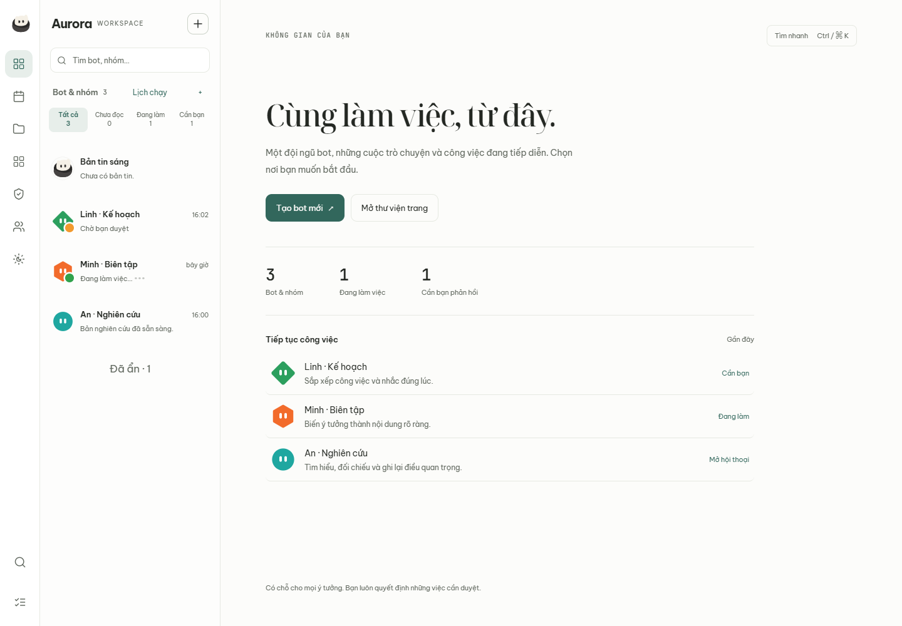
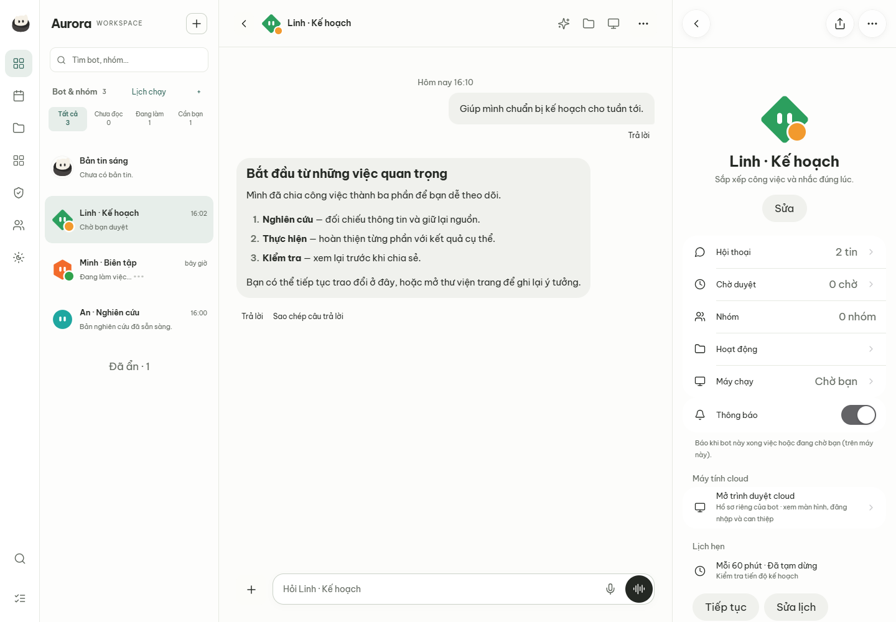

# OpenMausBot và thiết kế workspace Aurora — 2026-10-30

Aurora chuyển từ khung chat hẹp trên desktop sang workspace có thanh điều hướng, danh sách bot thường trực, hội thoại và bảng ngữ cảnh. Thay đổi lấy ý tưởng tổ chức công việc từ OpenMausBot, đồng thời giữ Tauri, Rust trusted host, Go control plane và Neko Core làm chủ agent loop. Đây là nghiên cứu source và triển khai UI cục bộ; không phải cam kết tương đương toàn bộ OpenMausBot.

## Nguồn và cách nghiên cứu

Reference được clone vào `reference/OpenMausBot`, tách khỏi Git của Aurora bằng `.git/info/exclude`. Snapshot: [`10af83e74dd7b5f7895fa498e0009c6ccc12a813`](https://github.com/milind-soni/OpenMausBot/tree/10af83e74dd7b5f7895fa498e0009c6ccc12a813), package `0.1.134`. Inventory có 6.192 file tracked, 2.149 đường dẫn source không phải test dưới `src/`, `server/`, `shared/`, và 36 entry point có hậu tố Panel/Page/View/Modal. Đây là inventory, không phải số tính năng hoặc tuyên bố đã kiểm toán từng dòng của 6.192 file.

Đã đi từ README và entry point ứng dụng đến navigation, chat, panel, state/API, persistence, optimistic send, admission và broker; đối chiếu màn hình Computer, Files, Triggers, Inspector, approval/question cards, cùng ảnh minh họa trong `docs/screenshots/`. Ảnh minh họa có thể cũ hơn source đã pin. Không cài dependency hoặc chạy reference. Bằng chứng inventory và nhật ký quyết định nằm trong `.audit/2026-10-30-openmaus/` của máy làm việc, không phân phối trong source checkout.

Áp dụng pstack Feature / Prove It Works / Show Me Your Work, redesign-existing-projects và webapp-testing. Theo yêu cầu của chủ dự án, toàn bộ nghiên cứu, triển khai và tự review do một agent thực hiện; không gọi đó là independent review.

## Bản đồ giao diện và chức năng cốt lõi

Các entry point dưới đây thuộc snapshot đã pin. Cột Aurora phân biệt phần triển khai ở lượt này với năng lực nền đã có và công việc còn tách riêng.

| Miền | Quan sát từ reference | Quyết định cho Aurora |
|---|---|---|
| Shell và navigation | `src/App.tsx`, `SidebarSimpleTop.tsx`, `SidebarSimpleRail.tsx`, `SidebarFooterNav.tsx`: danh sách liên tục, simple/advanced mode, panel theo ngữ cảnh | Triển khai rail 64px, sidebar 288px, home và context panel 360px. Không thay framework hoặc thêm hai bộ điều hướng độc lập. |
| Chat và composer | `ChatHeadPill.tsx`, `ChatEmptyState.tsx`, `state/optimistic-send.ts`: nhận diện bot, phản hồi sớm, liên kết bản optimistic với sendId | Sidebar chuyển bot trực tiếp; draft theo bot, receipt, retry không chắc chắn và hàng đợi gửi vẫn thuộc app hiện có. |
| Bot, nhóm và công việc | App/room panels phân biệt bot, room và ngữ cảnh task | Dùng bot/nhóm hiện có; filter chưa đọc/đang làm/cần bạn và active row. Không tạo thêm agent loop hoặc task store. |
| Tìm và lệnh | `CommandPalette.tsx`: truy cập nhanh hành động và đối tượng | Ctrl/Cmd+K tìm bot và lệnh điều hướng, bỏ dấu tiếng Việt khi so khớp; IME, phím mũi tên, Enter, Escape, Tab và trả focus. Tìm nội dung tin nhắn vẫn ở luồng tìm kiếm hiện có. |
| Phê duyệt và câu hỏi | `ApprovalCard.tsx`, `QuestionCard.tsx`: việc cần người dùng quyết định nằm ngay trong chat | Giữ cards, biểu mẫu, bản nháp và xác nhận gửi; home đưa các bot cần bạn lên đầu. Không tự chấp thuận công cụ vì giao diện được làm mới. |
| Máy tính | `ComputerPanel.tsx`, `BrowserPanel.tsx`, `LocalVmWorkspace.tsx`: phân biệt local/browser/cloud/VM, trạng thái khả dụng và chuyển quyền điều khiển | Nút Máy tính mở hồ sơ/context hiện có. Driver mới, VM và remote-control mới cần contract và acceptance riêng. |
| File và nội dung | `FilesView.tsx`, `ComputerFilesPane.tsx`, Data panel: file gắn với bot/máy tính và ngữ cảnh xem | Rail đưa Pages lên dễ tìm; upload/download và computer files hiện có giữ nguyên. Pages không được gọi là filesystem hoặc đồng bộ file. |
| Tự động hóa | `TriggersPage.tsx`: gom lịch, webhook và app event; có lọc bot, calendar, lần chạy và lỗi | Thêm tổng quan lịch từ API thật, lọc bot, cadence/timezone/trạng thái và đường dẫn vào editor hiện có. Chưa thêm webhook, app-event trigger hay calendar tổng hợp. |
| Kết nối | Connector/MCP panels, state API: cấu hình kết nối là luồng riêng, có trạng thái xác thực | Rail mở trang kết nối hiện có; MCP/OAuth vẫn theo receipt/revision và scope đã có. Không nhập danh mục Composio hay credentials của reference. |
| Model và công cụ | Bot settings/EnginesSettings: chọn engine theo bot và khả năng máy chạy | Toolbar vào AI & công cụ hiện có. Các model/CLI mới không được coi là tương thích chỉ nhờ có UI. |
| Bộ nhớ và skills | `bot-settings/MemorySection.tsx`, `SkillsSection.tsx`, `server/memory-entries.ts`: dữ liệu bền vững gắn bot, có grammar và thao tác riêng | Toolbar vào bộ nhớ hiện có; giữ revision/import/query boundaries. Chưa port classifier hoặc định dạng memory của OpenMaus. |
| Khóa và Vault | Keys/Login settings, broker: khóa ở phía host và quyền gọi có phạm vi | Vault có lối vào trực tiếp; không đưa token vào state của workspace hoặc localStorage mới. Preference mới chỉ lưu trạng thái thu gọn sidebar. |
| Hoạt động và chẩn đoán | `ActivityPanel.tsx`, `InspectorPanel.tsx`: hoạt động, trace và thông tin công cụ tách khỏi chat chính | Home chỉ dùng số liệu state thật; không dựng token/cost/trace giả. Inspector toàn cục là hạng mục riêng. |
| Voice và phone | LiveCall/Android panels, README: speech, provider voices, companion và khả năng theo OS | Giữ dictation/voice hiện có. Chưa triển khai WebRTC call, USB Android hoặc native phone companion theo reference. |
| Theme và localization | `styles.css`, i18n, media-query helpers: skin token và layout theo khả năng chứa panel | Dùng font/icon sẵn có của Aurora, palette teal, light/dark và các theme hiện có; giữ nguyên nội dung người dùng khi đổi ngôn ngữ. |
| Phân phối và enterprise | Electron shell, updater, optional enterprise adapter và entitlement | Giữ Tauri. Không port installer/updater/hosted tenancy hoặc enterprise code. |

Các đường dẫn component trong bảng thuộc `src/components/`, trừ khi đã chỉ rõ khác. Các nguồn chính có thể kiểm tra trực tiếp: [App](https://github.com/milind-soni/OpenMausBot/blob/10af83e74dd7b5f7895fa498e0009c6ccc12a813/src/App.tsx), [lazy screens](https://github.com/milind-soni/OpenMausBot/blob/10af83e74dd7b5f7895fa498e0009c6ccc12a813/src/components/lazy-screens.tsx), [ComputerPanel](https://github.com/milind-soni/OpenMausBot/blob/10af83e74dd7b5f7895fa498e0009c6ccc12a813/src/components/ComputerPanel.tsx), [TriggersPage](https://github.com/milind-soni/OpenMausBot/blob/10af83e74dd7b5f7895fa498e0009c6ccc12a813/src/components/TriggersPage.tsx), [FilesView](https://github.com/milind-soni/OpenMausBot/blob/10af83e74dd7b5f7895fa498e0009c6ccc12a813/src/components/FilesView.tsx).

## Những nguyên tắc quan trọng hơn hình thức

**Trạng thái có chủ sở hữu.** Reference tách state, API và persisted state; optimistic message được đối chiếu bằng sendId. Aurora giữ `S`, composer/outbox và receipt hiện có làm nguồn dữ liệu. `workspace.js` là lớp trình bày qua adapter của `app.js`, không giữ một bản bot/message store thứ hai. Danh sách lịch có workspaceId trong cả request và response; GET cũ không truyền scope vẫn tương thích với hồ sơ bot.

**Điều hướng không được ngầm thực thi.** Các nút rail gọi luồng Pages, kết nối, Vault, network và settings đã có. Tổng quan lịch chỉ đọc; nút quản lý mở đúng bot và editor cũ. Thử lại một kết quả gửi không chắc chắn tiếp tục cần thao tác rõ ràng của người dùng. Cách tự retry cùng sendId của [reference](https://github.com/milind-soni/OpenMausBot/blob/10af83e74dd7b5f7895fa498e0009c6ccc12a813/src/state/optimistic-send.ts) không được bê nguyên vào Aurora.

**UI cần phản ánh giới hạn runtime.** [Admission của reference](https://github.com/milind-soni/OpenMausBot/blob/10af83e74dd7b5f7895fa498e0009c6ccc12a813/server/admission.ts) tập trung quyết định nhận/đợi/từ chối theo từng nguồn công việc. [Broker](https://github.com/milind-soni/OpenMausBot/blob/10af83e74dd7b5f7895fa498e0009c6ccc12a813/server/bot-box/broker.ts) minh họa token có scope và upstream cố định. Bài học là phân biệt trạng thái trình bày với quyền thực thi. Lượt UI này không sửa admission, authority hay host grants của Aurora.

**Lỗi và ngữ cảnh là một phần của thiết kế.** Reference có màn hình tải lỗi riêng và panel gắn bot. Aurora tổng quan lịch có loading/empty/error/retry, timeout và hủy request khi đổi ngữ cảnh. Chuyển bot đóng hồ sơ bot cũ. Kết quả từ workspace cũ không xuất hiện ở workspace mới. Bộ lọc, palette và vùng recent không tiết lộ bot đã ẩn.

## Bố cục đã triển khai

- Dưới 900px: danh sách, chat và hồ sơ vẫn theo luồng một màn hình; lịch có nút quay lại riêng. Giữ luồng thao tác trên điện thoại thay vì ép ba cột.
- Từ 900px: rail và danh sách thường trực; chat dùng phần ngang còn lại. Có thể thu gọn danh sách và giữ preference qua reload.
- Từ 1280px: hồ sơ trở thành cột ngữ cảnh 360px cạnh chat; dưới ngưỡng này, phần bị hồ sơ phủ được đặt inert để không nhận focus.
- Home dùng bot và trạng thái thật; ưu tiên bot chờ phản hồi, có tạo bot, Pages và tìm nhanh. Không hiển thị chỉ số thành tích hoặc dữ liệu demo trong sản phẩm.
- Chat có toolbar AI & công cụ / bộ nhớ / máy tính, chiều rộng nội dung có giới hạn để dễ đọc, giữ draft khi chuyển bot.
- Giữ message đang đọc khi đổi viewport hoặc thu gọn sidebar; tránh tích lũy sai số làm trôi vị trí. Không thay DOM selection hoặc receipt logic.

Entry point: `app/native/internal/web/assets/app/workspace.js`, `workspace.css`, `index.html` và adapter cuối `app.js`. Asset registry và service-worker allowlist đã bổ sung module/CSS/font sẵn có; API không nằm trong cache allowlist.

## Ảnh giao diện đã kiểm tra

Ảnh từ Chrome với dữ liệu fixture, source `6f93ea26dbe7d99e60b0e63fc6df2fee1c5fc471`; không phải tài khoản thật hoặc ảnh OpenMausBot. [Provenance và hash](../assets/README.md).

## Giấy phép và phạm vi còn lại

Theo [LICENSING](https://github.com/milind-soni/OpenMausBot/blob/10af83e74dd7b5f7895fa498e0009c6ccc12a813/LICENSING.md), core reference dùng Apache-2.0, `enterprise/` có license riêng; tên và mascot là trademark. [NOTICE](https://github.com/milind-soni/OpenMausBot/blob/10af83e74dd7b5f7895fa498e0009c6ccc12a813/NOTICE) còn liệt kê nhiều thành phần bên thứ ba. Lượt này không sao chép source hoặc asset OpenMausBot vào Aurora, không đổi giấy phép các component Aurora và không dùng mascot của reference.

Những phần cần dự án triển khai/acceptance riêng: Files workspace thống nhất; Inspector/Activity toàn cục; lịch dạng calendar, webhook và app events; panel resize bằng kéo; simple/advanced mode hoàn chỉnh; VM/native computer integrations; phone companion/WebRTC; team marketplace; hosted/enterprise/update distribution. Bản đồ này không đánh dấu các phần đó là đã làm. Giới hạn nền Grok Bot được giữ trong các báo cáo adoption hiện có.

[Cách dùng workspace](../workspace.md) · [Kết quả kiểm thử và commit](openmaus-validation-2026-10-30.md)
